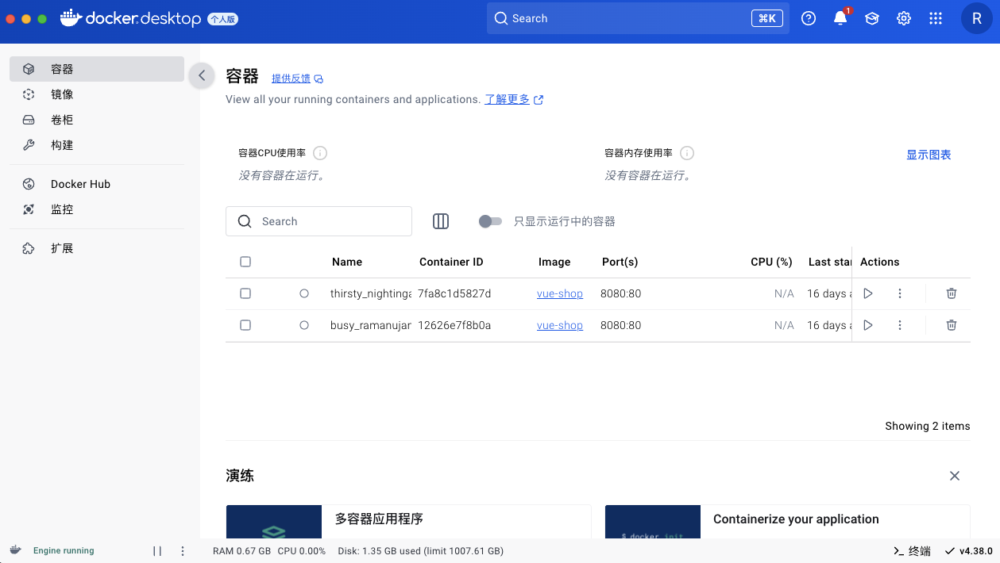
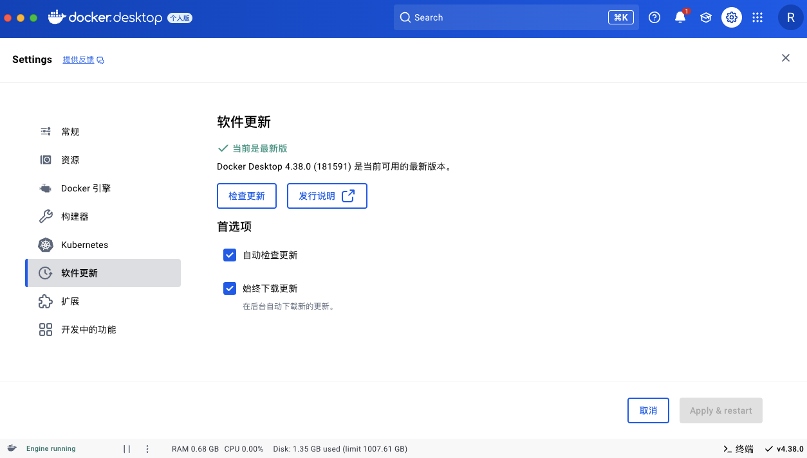
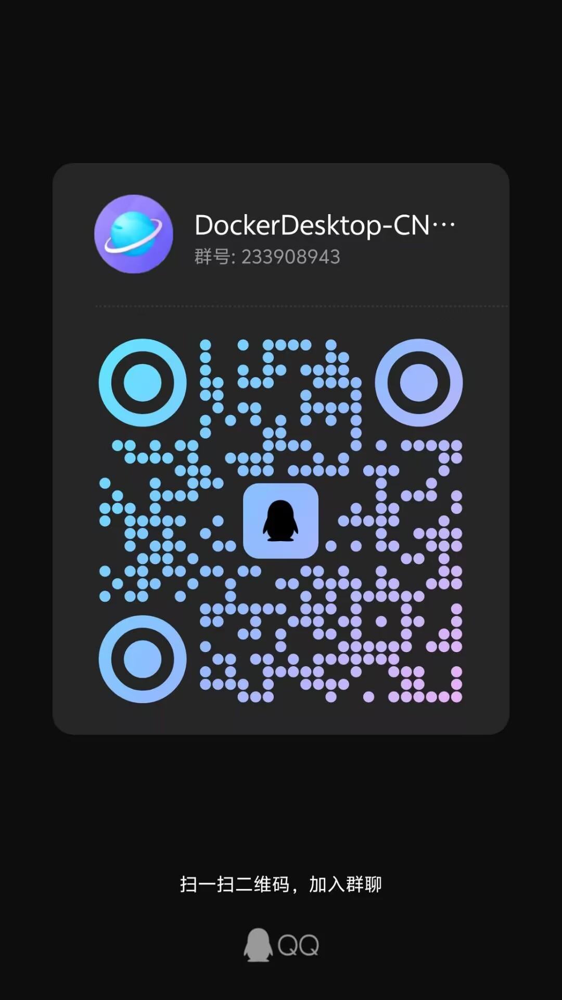

# Docker Desktop 汉化包

本仓库同时提供 Docker Desktop 汉化包与汉化脚本，Release 页面会随 Docker Desktop 版本发布对应平台安装程序和汉化包。

> 原脚本仓库 [asxez/DDCS](https://github.com/asxez/DDCS) 已归档，脚本源码已迁移到本仓库，后续维护与发布都在这里进行。

Docker汉化  Docker中文版  Docker Desktop汉化 Docker Windows Docker MAC

Windows x86 / Windows arm / macOS Apple Silicon / macOS Intel / Debian x86 均提供汉化包，以 Release 实际产物为准。

**注意: 自 4.39 版本后，汉化包会跟随 Docker Desktop 安装程序一起发布在 [Releases](https://github.com/asxez/DockerDesktop-CN/releases) 页面。**

## 下载汉化包

Release 中的汉化包为 `app-*.zip`：

- `app-Windows-x86.zip`
- `app-Windows-arm.zip`
- `app-Mac-apple.zip`
- `app-Mac-intel.zip`
- `app-Debian-x86.zip`

汉化包内容：

- Windows 包含 `app.asar`、`app.asar.unpacked`、已同步完整性校验的 `Docker Desktop.exe`，以及一键安装/恢复脚本 `安装汉化.bat`、`恢复原版.bat`。
- macOS 包含 `app.asar`、`app.asar.unpacked` 和已同步完整性校验的 `Info.plist`。
- Linux 包含 `app.asar` 和 `app.asar.unpacked`。

Docker Desktop 4.74.0 起，Windows 版会校验 `app.asar` 完整性。只替换 `app.asar` 会导致 Docker Desktop 无法启动，并出现 `Integrity check failed for asar archive`。Windows 用户必须同时替换 `app.asar`、`app.asar.unpacked` 和汉化包内的 `Docker Desktop.exe`。
macOS 同样会校验 `app.asar` 完整性，校验值位于内层 `Docker Desktop.app/Contents/Info.plist`。macOS 用户必须同时替换 `app.asar`、`app.asar.unpacked` 和汉化包内的 `Info.plist`。

## 汉化包使用方法

### Windows：一键安装（推荐）

1. 完全退出 Docker Desktop（托盘图标右键退出）。
2. 下载并解压对应架构的 `app-Windows-x86.zip` 或 `app-Windows-arm.zip`。
3. 双击压缩包内的 `安装汉化.bat`。
4. Windows 弹出 UAC 提示时选择“是”，等待脚本自动完成备份、替换和校验。
5. 完成后按提示启动 Docker Desktop。

安装脚本会自动完成以下操作：

- 定位 Docker Desktop 实际安装目录，支持 `C:\Program Files\Docker\Docker` 和 `%LOCALAPPDATA%\Programs\DockerDesktop`。
- 关闭正在运行的 Docker Desktop。
- 备份 `app.asar`、`app.asar.unpacked` 和 `Docker Desktop.exe` 到 `%LOCALAPPDATA%\DockerDesktop-CN\backup\<时间戳>`。
- 替换 `app.asar`、`app.asar.unpacked` 和 `Docker Desktop.exe`，并校验 `app.asar`。
- 如版本不一致会提示确认，避免把汉化包用到错误版本。

如需恢复原版，双击压缩包内的 `恢复原版.bat`，按提示选择备份即可。压缩包内还包含 `使用说明.txt`。

### Windows：手动安装（脚本不可用时）

下文 Windows 示例使用 `C:\Program Files\Docker\Docker` 作为安装根目录。如果 Docker Desktop 安装在其他位置，请将步骤中的安装根目录替换为实际路径。

在每用户安装场景中，安装根目录也可能是 `%LOCALAPPDATA%\Programs\DockerDesktop`（参见 [#82](https://github.com/asxez/DockerDesktop-CN/issues/82)）。安装在该位置时，需要备份和操作的文件为：

- `%LOCALAPPDATA%\Programs\DockerDesktop\frontend\resources\app.asar`
- `%LOCALAPPDATA%\Programs\DockerDesktop\frontend\resources\app.asar.unpacked`
- `%LOCALAPPDATA%\Programs\DockerDesktop\frontend\Docker Desktop.exe`

可以查看 Docker Desktop 快捷方式的“目标”确认可执行文件位置，再检查同一目录下的 `resources\app.asar` 与 `resources\app.asar.unpacked`。PATH 中的 `resources\bin` 路径、卸载项的 `InstallLocation` 也可以作为线索。以实际存在的文件为准，避免把汉化包复制到未使用的旧安装目录。

Windows 手动操作步骤：

1. 完全退出 Docker Desktop（建议同时执行 `wsl --shutdown`）。
2. 下载当前 Docker Desktop 版本对应的 `app-Windows-*.zip` 汉化包并解压。
3. 备份原文件：
   - `frontend\resources\app.asar`
   - `frontend\resources\app.asar.unpacked`
   - `frontend\Docker Desktop.exe`
4. 替换文件：
   - 用汉化包内的 `app.asar` 替换 `frontend\resources\app.asar`。
   - 用汉化包内的 `app.asar.unpacked` 替换整个 `frontend\resources\app.asar.unpacked` 目录。
   - 用汉化包内的 `Docker Desktop.exe` 替换 `frontend\Docker Desktop.exe`。
5. 启动 Docker Desktop。

Windows 手动操作请使用管理员权限；恢复原版时，也需要将备份的 `Docker Desktop.exe`、`app.asar` 和 `app.asar.unpacked` 一起恢复。

### macOS / Linux：手动安装

1. 完全退出 Docker Desktop。
2. 下载对应平台的 `app-*.zip` 汉化包并解压。
3. 备份原文件：
   - macOS: `/Applications/Docker.app/Contents/MacOS/Docker Desktop.app/Contents/Resources/app.asar`
   - macOS: `/Applications/Docker.app/Contents/MacOS/Docker Desktop.app/Contents/Resources/app.asar.unpacked`
   - macOS: `/Applications/Docker.app/Contents/MacOS/Docker Desktop.app/Contents/Info.plist`
   - Debian/Ubuntu: `/opt/docker-desktop/resources/app.asar`
   - Debian/Ubuntu: `/opt/docker-desktop/resources/app.asar.unpacked`
4. 文件操作：
   - macOS: 将汉化包内的 `app.asar`、`app.asar.unpacked` 替换到 `/Applications/Docker.app/Contents/MacOS/Docker Desktop.app/Contents/Resources`，将 `Info.plist` 替换到 `/Applications/Docker.app/Contents/MacOS/Docker Desktop.app/Contents/Info.plist`。
   - Debian/Ubuntu: 将汉化包内的 `app.asar` 和 `app.asar.unpacked` 替换到 `/opt/docker-desktop/resources`。
5. macOS 不要对 Docker Desktop 执行 ad-hoc 重签名。如果之前已经重签过，请先恢复备份或重装原版 Docker Desktop 后再替换。
6. 启动 Docker Desktop。

macOS 用户恢复原版时，也需要将备份的 `Info.plist`、`app.asar` 和 `app.asar.unpacked` 一起恢复。

## 使用汉化脚本

仓库根目录即为汉化脚本源码，`ddcs.py` 会自动定位本机 Docker Desktop 安装目录，完成解包、替换、重打包和完整性校验同步。

### 环境需求

- Python >= 3.10
- Node.js >= 22

### 安装依赖

```bash
pip install -r requirements.txt
npm install
```

### 执行汉化

Windows 请务必使用**管理员权限**启动终端，并先完全退出 Docker Desktop，然后进入仓库根目录执行：

```bash
python ddcs.py
```

macOS / Linux 直接执行同一命令即可。

注意：

- Docker Desktop 4.74.0 及以上版本会校验 `app.asar` 完整性。Windows 会在 `Docker Desktop.exe` 中记录 asar header hash，macOS 会在 `Docker Desktop.app/Contents/Info.plist` 的 `ElectronAsarIntegrity` 中记录该 hash。脚本会在替换 `app.asar` 后同步更新这些校验信息；如果没有权限，脚本会提前报错，Docker Desktop 将无法正常启动。
- 如需使用旧版 `config.json` 精确替换逻辑，可运行 `python ddcs.py --legacy`。
- 汉化前请备份 `app.asar`、`app.asar.unpacked` 和 `Docker Desktop.exe`（Windows）或 `Info.plist`（macOS），方便回滚。

## 自动提取（翻译者 / 开发者）

通过正则和简单的代码分析，自动提取 Docker Desktop 页面中出现的文本，并保存到 [extract_config.py](./lib/extract_config.py)。

### Docker Desktop 4.74.0+ 完整性校验

4.74.0 起，Windows 版 Docker Desktop 会在 `Docker Desktop.exe` 中记录 `resources\app.asar` 的完整性信息；macOS 会在内层 `Docker Desktop.app/Contents/Info.plist` 的 `ElectronAsarIntegrity` 中记录 `Resources/app.asar` 的完整性信息。这里的 hash 是 `app.asar` header JSON 的 SHA256，不是整个 `app.asar` 文件的 SHA256。修改或重新打包 `app.asar` 后，必须同步更新该 hash，否则 Electron 会报 `Integrity check failed for asar archive` 并拒绝启动。

### 提取与翻译流程

1. 运行自动提取（仅在 Docker Desktop 发布新版本后需要）：

   ```bash
   # 默认与 ddcs.py 一致，自动寻找本机 Docker Desktop app.asar 并解包
   python ddcs_extract.py
   ```

   或手动解包 asar 后指定路径：

   ```bash
   python ddcs_extract.py --path xxx
   ```

2. 进行翻译。

   [extract_config.py](./lib/extract_config.py) 中的 `config` 是一个 `Config` 列表：

   ```python
   [Config(src=英文, dst=中文, deleted_at=None), ...]
   ```

   运行自动提取后，新增配置项中：

   - `src`：英文文本
   - `dst`：为空字符串 `""` 的中文文本
   - `deleted_at`：如果旧配置项在当前版本没有提取到，会设置为当前版本号

   请在 [extract_config.py](./lib/extract_config.py) 中搜索空字符串并进行翻译。

   注意事项：

   - 英文文本可能为包含 JS 变量的模板字符串，如 `Images (${c.images.count})`，翻译后的中文应当保留变量，即 `镜像（${c.images.count}）`。
   - 英文文本可能为包含替换字段（`{0}`、`{1}` 等）的格式化字符串，如 `Select {0} in the {1} column to see it running.`，翻译后的中文应当保留替换字段，即 `在 {1} 列选择 {0} 以查看其运行情况`。如果替换字段遗漏，替换阶段会输出警告日志。
   - 对于不需要翻译的项目，请不要删除，而是将中文值设为 `None`，如 `("Python", None)`。
   - 对于没有自动提取的文本，请添加到 [extract_config_manually.py](./lib/extract_config_manually.py)。

   提取示例：

   ```diff
   config: List[Config] = [
   - Config(src="outdated text", dst="过时文本"),
   + Config(src="outdated text", dst="过时文本", deleted_at="4.50.0"),
   + Config(src="new text in {0}", dst="", deleted_at=None),
   + Config(src="Python", dst="", deleted_at=None),
   ]
   ```

   翻译后：

   ```diff
   config: List[Config] = [
   - Config(src="outdated text", dst="过时文本"),
   + Config(src="outdated text", dst="过时文本", deleted_at="4.50.0"),
   + Config(src="new text in {0}", dst="{0} 中的新文本", deleted_at=None), # 保持模板变量
   + Config(src="Python", dst=None, deleted_at=None), # 专业词汇不需要翻译
   ]
   ```

3. 验证翻译：

   ```bash
   python ddcs.py
   ```

   替换后启动 Docker Desktop，逐页验证。自动提取不可能完全精准，可能出现：

   - 遗漏部分内容：某些地方仍为英文；将文本添加到 `extract_config_manually.py` 或优化 `extract.py`。
   - 错误提取：Docker Desktop 页面出现报错；根据报错定位错误文本并修复（大多出现在 `extract_config_manually.py` 中，如漏掉引号等）。

## 发布流程

Release 由 `.github/workflows/release.yml` 每日检查 Docker Desktop 新版本并自动构建，也可以手动触发。本地构建可执行：

```bash
./release.sh
```

脚本会下载五个平台的安装包，提取 `app.asar`、执行汉化、重新打包并同步完整性校验，最后通过 `gh release create` 发布到本仓库 Releases。

> Docker Desktop 4.97.0 起，Windows 安装包改为自定义 PE 结构，`app.asar` 位于 PE 资源 `DOCKERDESKTOP` 的内嵌 7z 中。`release.sh` 会调用 `tools/extract_windows_payload.py` 自动提取，无需手动处理。

## 效果图

### Windows


### Mac




## 更多问题？

有问题的可以扫码加群咨询。



## Stars

如果你觉得本仓库对你有用的话，请点上一颗 star。
